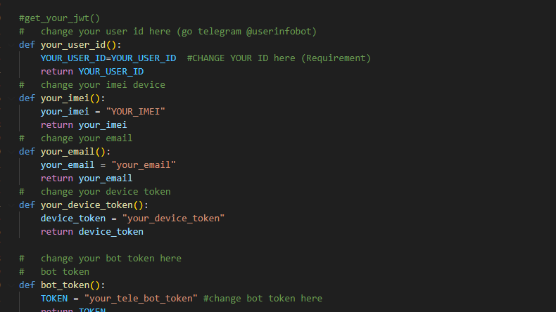
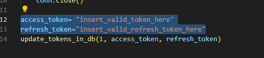
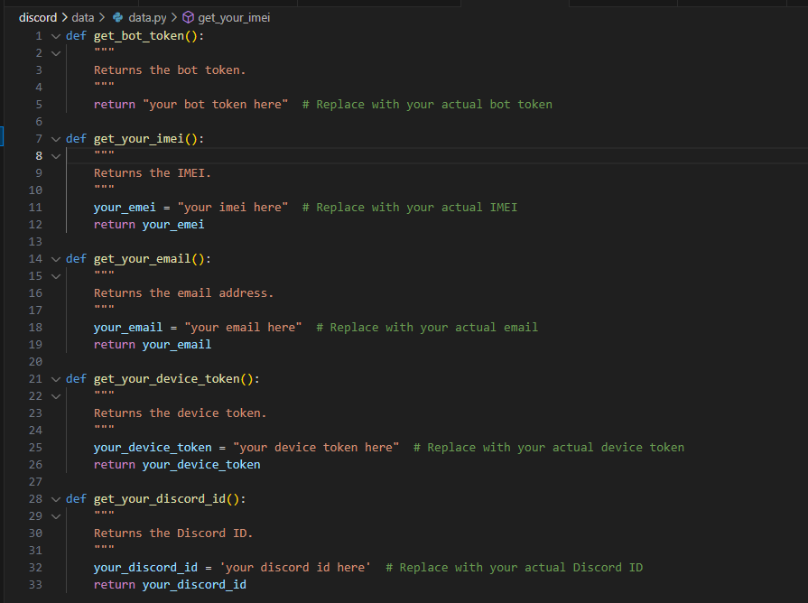

# Hướng Dẫn Cài Đặt & Sử Dụng FoxPro Bot

# Bot Server Telegram & Discord

## Giới Thiệu Dự Án

**Bot Server Telegram & Discord** là một dự án mã nguồn mở giúp tự động hóa quá trình checkin, checkout và quản lý thông tin cá nhân cho người dùng trên hai nền tảng phổ biến: Telegram và Discord. Dự án hỗ trợ các lệnh tương tác nhanh, dễ sử dụng, phù hợp cho các nhóm làm việc, cộng đồng hoặc tổ chức cần quản lý thời gian làm việc.

### Tính Năng Nổi Bật

- Tích hợp đồng thời trên Telegram và Discord.
- Hỗ trợ checkin, checkout, xem lịch làm việc, lấy thông tin cá nhân.
- Dễ dàng cấu hình và mở rộng.
- Hướng dẫn cài đặt chi tiết, phù hợp cho cả người mới bắt đầu.

---
# Hướng Dẫn Cài Đặt & Sử Dụng Bot Server Discord

## Yêu Cầu Thư Viện

Trước khi khởi chạy bot Telegram, vui lòng cài đặt đầy đủ các thư viện cần thiết:

```bash
pip install -r requirements.txt
```

**Nội dung mẫu của `requirements.txt`:**
```
psutil==6.1.1
python-telegram-bot==13.13
requests==2.32.3
```

---

## Cấu Hình Thông Tin Cá Nhân

Chỉnh sửa tệp `maindev/your_information.py` với thông tin cá nhân của bạn:



---

## Cập Nhật JWT Cho App Checkin

Để sử dụng song song giữa Telegram bot và app checkin, cập nhật thông tin JWT trong `maindev/db/update_jwt_manual.py`:

- Chỉnh sửa biến `access_token` theo JWT bạn lấy được.



Sau đó, chạy lệnh sau để cập nhật JWT thủ công:

```bash
python3 maindev/db/update_jwt_manual.py
```

> **Lưu ý:** Sử dụng BurpSuite để bắt request app và lấy JWT.

---

## Khởi Động Bot Telegram

Để chạy bot Telegram ở chế độ nền:

```bash
python3 maindev/run.py
```

---

## Các Lệnh Tương Tác Với Bot

Sau khi bot chạy thành công, bạn có thể sử dụng các lệnh sau:

| Lệnh                | Chức năng                                      |
|---------------------|------------------------------------------------|
| `/c`                | Checkin                                        |
| `/o`                | Checkout                                       |
| `/p`                | Lấy thông tin người dùng (tên, seniority)      |
| `/a month date`     | Lấy lịch làm việc trong tháng                  |

---

# Hướng Dẫn Cài Đặt & Sử Dụng Bot Server Discord

## Yêu Cầu Thư Viện

Cài đặt các thư viện cần thiết trước khi chạy bot server:

```bash
pip install -r discord/requirements.txt
```

**Nội dung `discord/requirements.txt`:**
```
beautifulsoup4==4.12.3
discord.py==2.5.2
psutil==6.1.1
PyJWT==2.10.1
urllib3==2.2.3
Requests==2.32.3
```
## Cấu Hình Thông Tin Cá Nhân

Chỉnh sửa tệp `discord/data/data.py` với thông tin cá nhân của bạn:



---

## Khởi Động Bot Discord

Để chạy bot Telegram ở chế độ nền:

```bash
python3 discord/run.py
```

---

## Các Lệnh Tương Tác Với Bot

Sau khi bot chạy thành công, bạn có thể sử dụng các lệnh sau:

| Lệnh                | Chức năng                                      |
|---------------------|------------------------------------------------|
| `!c`                | Check in                                       |
| `!exit`             | Check out                                      |
| `!h`                | lấy lệnh trợ giúp                              |

---